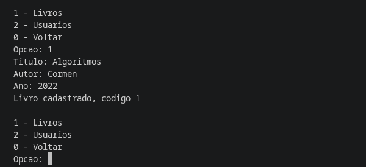
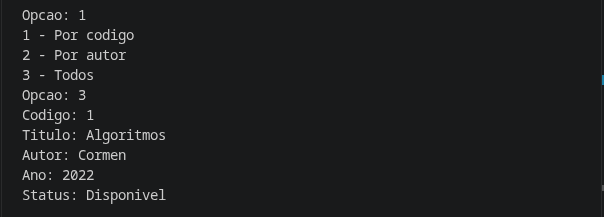
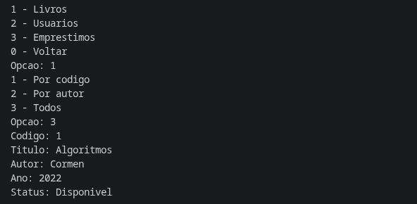
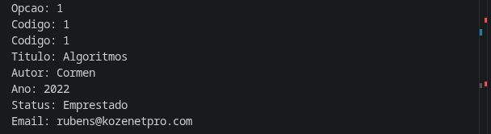
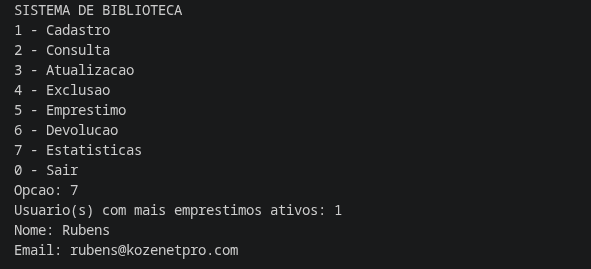

# Sistema de Controle de Biblioteca

Trabalho final de Estrutura de Dados I em C

## Funcionalidades

- Cadastro, consulta, atualização e exclusão de livros e usuários
- Busca de livros por código ou autor
- Busca de usuários por email ou nome
- Listagem de todos os livros
- Empréstimo e devolução
- Consulta dos empréstimos ativos de um usuário
- Estatística do usuário com mais empréstimos ativos

## Estruturas utilizadas

Livros e usuários são armazenados em listas simplesmente encadeadas com alocação dinâmica

Os livros são mantidos em ordem de código

Os dados ficam em memória e são perdidos ao sair

As entradas de texto não devem conter espaços, conforme o enunciado

## Compilar e executar

Na pasta do projeto, compile com o comando apresentado nas aulas:

```sh
gcc -Wall main.c biblioteca.c -o biblioteca
```

Execute:

```sh
./biblioteca
```

## Exemplo de uso

Escolha `1 - Cadastro` e depois `1 - Livros` para cadastrar um livro

Use `2 - Consulta`, `1 - Livros` e `3 - Todos` para listar os livros

Escolha `7 - Estatisticas` para ver o usuário com mais empréstimos ativos

## Demonstração do sistema

Menu principal com as opções disponíveis


Cadastro de um livro



Cadastro de um usuário


Consulta dos dados de um livro



Listagem dos livros cadastrados



Empréstimo de um livro


Consulta de um livro emprestado



Devolução de um livro


Estatísticas de empréstimos ativos


